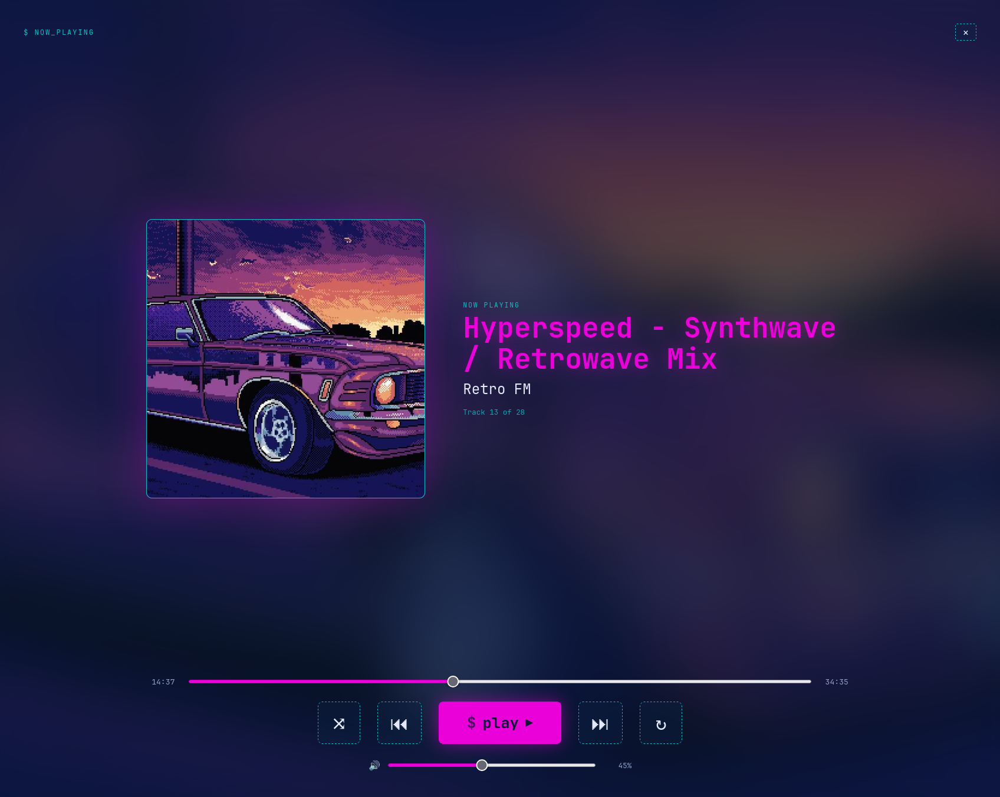

# recvrd

> **v0.7.0.** `recvrd` is an A/V receiver daemon for music, podcasts, video
> and live TV. The audio path works today; video and live TV are future work.
> `recvrd` is a headless fork of
> [ytermusic](https://github.com/ccgauche/ytermusic), adding a web UI, terminal
> client, MPRIS and MCP. The daemon, REST/SSE API, web UI, terminal client,
> MPRIS, MCP, playlist editing and packaging work today.

[Build plan](https://sb.ser.ink/llm-wiki/concepts/recvrd-build-plan) ·
[Roadmap](https://github.com/recvrd/recvrd/issues/25) ·
[Issues](https://github.com/recvrd/recvrd/issues)



## What it is

`recvrd` keeps playback, queue and downloads in a long-running daemon. It
serves local files, RSS feeds, Podverse channels and YouTube Music. A manual
offline switch serves cached content without provider calls. Clients are thin:

- **Web UI** — library, search, queue, now playing, cover art, vim-style keys
  and playlist editing.
- **Terminal client** — `recvc`, with library, search, queue, now playing,
  cover art, vim keys and mouse actions.
- **MCP** — a stdio proxy exposing search/playback tools to assistants.
- **MPRIS** — desktop media controls with cover art (`playerctl`, shell media
  widgets).

The API is the contract. State and DTOs live in the daemon/API crates; the web
UI, terminal client and MCP proxy are clients.

## Status

| Area | State |
| --- | --- |
| Workspace, daemon skeleton, Nix dev shell | ✅ |
| Local dev/test workflow (`just`, offline tests) | ✅ |
| Auth/config/path extraction | ✅ |
| Playback, queue, downloads, event bus, MPRIS | ✅ |
| Full REST + SSE API | ✅ |
| Playlist create, rename, delete and track edits | ✅ |
| Web UI (library, search, queue, now playing, vim keys) | ✅ |
| Terminal client (`recvc`, mouse and vim keys) | ✅ |
| systemd unit, Nix package/module | ✅ |
| MCP proxy (36 tools) | ✅ |
| Offline mode with cached content | ✅ |
| v0.7.0 release | ✅ |

See the [roadmap](https://github.com/recvrd/recvrd/issues/25) for the
ordered backlog.

## Quickstart

Requirements: Nix with flakes (recommended), or Rust 1.99+, Node 22+ and the
native libraries listed in the [dev shell](flake.nix).

```sh
git clone git@github.com:recvrd/recvrd.git
cd recvrd
nix develop

cargo run -p recvrd -- --help
cargo run -p recvrd -- serve
```

Or run the packaged daemon directly:

```sh
nix run .#recvrd -- serve
```

In another shell:

```sh
curl http://127.0.0.1:8080/api/status
```

`serve` binds `127.0.0.1:8080` by default. Override it with `--bind`, `--port`,
`RECVRD_BIND` or `RECVRD_PORT`. It shuts down gracefully on
SIGINT/SIGTERM. Open `http://127.0.0.1:8080` for the web UI. See
[docs/api.md](docs/api.md) for the full endpoint reference, SSE stream and curl
examples.

The repository build embeds the web app. If the UI shows a "not built" page,
run `just web-install && just web-check`, then restart the daemon. For frontend
development, use `just web` and the Vite proxy.

Run the terminal client in another shell:

```sh
cargo run -p recvc
# or
nix run .#recvc
```

The client uses the running daemon. See [docs/tui.md](docs/tui.md).

## Authentication

`recvrd` uses YouTube Music browser cookies. Create a `headers.txt` with:

```
Cookie: <cookie>
User-Agent: Mozilla/5.0 ...
```

1. Open https://music.youtube.com in your browser.
2. Open developer tools (F12).
3. In the Network tab, open the page request for `/`.
4. Copy the `Cookie` header (Firefox: enable **Raw** first).
5. Copy the `User-Agent` header.
6. Save both to `headers.txt` in the config directory.

The current client checks `./headers.txt` and the XDG config directory. The
daemon resolves headers in this order:

1. `--headers <path>` / `RECVRD_HEADERS`
2. `$XDG_CONFIG_HOME/recvrd/headers.txt`
3. `$XDG_CONFIG_HOME/ytermusic/headers.txt` (legacy, with a warning)

It validates the cookie and `SAPISID` at startup. It also reads the YouTube
Music login state. An expired session leaves search and playback available.
The library and playlist actions fail with an `auth_expired` error until you
refresh `headers.txt` and restart the daemon. The daemon never prompts on
stdin.

Brand accounts: copy the account ID from `myaccount.google.com` (the number
after `/b/`) into `account_id.txt` next to `headers.txt`.

**Never commit `headers.txt`, `account_id.txt`, cookies or logs containing
them.** They are gitignored.

## Configuration

The daemon reads `$XDG_CONFIG_HOME/recvrd/config.toml` (usually
`~/.config/recvrd/config.toml`). See
[config.example.toml](config.example.toml) for the available fields and
defaults. CLI flags and environment variables override the config file:

| Option | Environment |
| --- | --- |
| `--bind` | `RECVRD_BIND` |
| `--port` | `RECVRD_PORT` |
| `--headers` | `RECVRD_HEADERS` |
| `--config` | `RECVRD_CONFIG` |
| `--url` (`mcp` and `recvc`) | `RECVRD_URL` |

`config.toml` parse errors, invalid values and malformed headers are reported
with the file path; they are never silently replaced with defaults.

`cache_limit_mb` caps the download cache (default 10240 MiB, 0 disables). When
it is exceeded, the oldest complete downloads are evicted, keeping the current
queue. The cover cache has its own `cover_cache_mb` limit.

To enable the local-files provider, add a `[local]` table with a music
directory. The provider is hidden from `/api/providers` when the table is
absent. It scans `mp3`, `m4a`, `ogg`, `flac`, and `wav` files.

```toml
[local]
music_dir = "/home/user/Music"
```

`RECVRD_LOCAL_DIR` overrides the file value. The file name is the track
title. Tag metadata and cover art are not read yet.

To enable the Podverse provider, add a `[podverse]` table with the API base
URL. The provider is hidden from `/api/providers` when the table is absent.

```toml
[podverse]
base_url = "https://podverse.example.com/api/v2"
# token = "optional-bearer-token"
```

`RECVRD_PODVERSE_URL` and `RECVRD_PODVERSE_TOKEN` override the file values.
The instance domain is never built into the daemon.

## Development

```sh
nix develop
just check
just test
```

- [docs/testing.md](docs/testing.md) — local workflow, fixtures, regression policy
- [docs/api.md](docs/api.md) — REST/SSE reference, curl examples and reconnect semantics
- [docs/web.md](docs/web.md) — web UI development, keymap and failure states
- [docs/tui.md](docs/tui.md) — terminal client, keys, mouse and limits
- [docs/mcp.md](docs/mcp.md) — MCP client setup and the 36 tools
- [docs/release.md](docs/release.md) — release checklist and smoke tests
- [CHANGELOG.md](CHANGELOG.md) — release notes
- [CONTRIBUTING.md](CONTRIBUTING.md) — contribution rules
- [AGENTS.md](AGENTS.md) — worktree-per-issue workflow for agents
- [docs/architecture.md](docs/architecture.md) — daemon/API/client design
- [docs/deployment.md](docs/deployment.md) — systemd user service and environment
- [docs/decisions](docs/decisions/) — architecture decision records
- [0004 — upstream strategy](docs/decisions/0004-upstream-strategy.md) — fork-first with selective upstreaming
- [0005 — terminal client](docs/decisions/0005-tui-client.md) — `recvc` is a daemon client
- [0006 — playback modes](docs/decisions/0006-playback-modes.md) — per-provider download, stream or stream-then-download

### Workspace layout

- `crates/recvrd` — daemon binary (`serve`, `mcp`)
- `crates/recvrd-core` — headless paths, config, auth, playback/queue and event bus
- `crates/recvrd-api` — shared DTOs and generated TypeScript bindings
- `crates/recvrd-web` — Svelte 5 web UI (embedded in the daemon)
- `crates/recvrd-client` — shared HTTP/SSE client for the daemon
- `crates/recvc` — terminal client (`recvc`)
- `crates/ytpapi2` — YouTube Music API client
- `crates/provider-youtube` — YouTube Music provider: API client, cover fetcher and downloads
- `crates/provider-rss` — RSS provider: feed parser, store, fetcher and downloader
- `crates/provider-podverse` — Podverse provider: channel search, item metadata, fetcher and downloader
- `crates/player` — audio playback
- `crates/database` — local download database
- `crates/download-manager` — download queue
- `crates/common-structs` — shared status types

## API

The daemon implements the full v1 REST + SSE contract. Examples:

```sh
curl http://127.0.0.1:8080/api/status
curl http://127.0.0.1:8080/api/playlists
curl 'http://127.0.0.1:8080/api/search?q=civilization'
curl -N http://127.0.0.1:8080/api/events
```

See [docs/api.md](docs/api.md) for every endpoint, request/response shapes,
error handling, SSE event types and `Last-Event-ID` replay. Playing a playlist
or track queues the audio for download by default; playback starts when the
cached file is ready, and failed downloads can be retried from the API or UI.
RSS and Podverse tracks can also stream instead. The mode is per provider:
`download`, `stream` or `stream_then_download`, changed with
`PUT /api/providers/{provider}/playback`. The choice is saved in
`$XDG_CONFIG_HOME/recvrd/settings.toml`. The daemon serves the web UI at `/`
and the API under `/api`.

## MCP

`recvrd mcp` is a stdio proxy to the daemon. It exposes 36 tools:
`search`, `list_playlists`, `get_playlist`, `get_track`, `create_playlist`,
`rename_playlist`, `delete_playlist`, `add_playlist_tracks`,
`remove_playlist_tracks`, `move_playlist_track`, `play_playlist`, `play_track`,
`queue_add`, `queue_remove`, `queue_reorder`, `queue_play_next`,
`queue_clear`, `retry_download`, `now_playing`, `pause`, `resume`, `next`,
`previous`, `volume`, `seek`, `shuffle`, `repeat`, `download_status`,
`list_providers`, `set_playback_mode`, `set_offline`, `rss_list_feeds`, `rss_add_feed`,
`rss_remove_feed`, `rss_refresh_feed` and `rss_refresh_feeds`.

```sh
recvrd mcp
RECVRD_URL=http://127.0.0.1:9000 recvrd mcp
```

See [docs/mcp.md](docs/mcp.md) for client configuration, tool arguments and
error behavior. Lyrics and HTTP transport are post-v1.

## Troubleshooting

**The daemon exits with a cookie or `SAPISID` error.** Refresh `headers.txt`.
See [Authentication](#authentication). The daemon never prompts on stdin.

**The API returns 401 with `auth_expired`.** The YouTube Music session expired.
Refresh `headers.txt` and restart the daemon. The web UI shows a sign-in
banner. Search and playback still work.

**The API returns 502.** An upstream request failed. Check the network and
the daemon log. The web UI shows the message in a toast.

**The web UI shows "not built".** Run `just web-install && just web-check`.
Then restart the daemon.

**There is no audio.** Check the PipeWire device. Run `wpctl status` and
check the daemon log. The first start can wait for a download.

**MPRIS does not appear in `playerctl -l`.** Check the D-Bus session and set
`dbus = true` in `config.toml`. The daemon continues without MPRIS if D-Bus is
not available.

**The port is in use.** Set `--port` or `RECVRD_PORT`.

**A state file is corrupt.** The daemon moves it to `state.json.bad` and starts
with an empty queue. A log line shows the path.

**More logs.** Set `RUST_LOG=recvrd=debug`.

## Migrating from ytermusicd

`recvrd` moves the old `ytermusicd` directories to the new `recvrd` paths on
first start. It renames the directory when it can. When a rename fails, it
symlinks the old directory on Unix, or copies the config, state and data. A
cache directory that cannot be moved is left in place; the daemon downloads
the files again.

The old `ytermusicd` and `ytmc` binaries, `YTERMUSICD_*` variables and Nix
options remain aliases for one release. The removal release is the next major
release.

## Migrating from upstream ytermusic

The upstream `ytermusic` TUI and the daemon use different XDG directories. The
daemon reads a legacy `com/ccgauche/ytermusic/headers.txt` with a warning. It
does not import the upstream playlist file or queue. Downloaded files are not
moved.

To migrate:

1. Copy the cookie headers to `$XDG_CONFIG_HOME/recvrd/headers.txt`.
2. Copy downloaded files to `$XDG_CACHE_HOME/recvrd/downloads/`.
3. Start the daemon and select a playlist in the web UI.

The `recvc` client uses the daemon, so it does not need migration.

## Terminal client

`recvc` is a thin terminal client for the daemon. It shows the same
queue and playback state as the web UI. It supports vim keys, mouse actions,
cover art and playlist edits. See [docs/tui.md](docs/tui.md) for keys, mouse
actions and limits.

## License and attribution

Apache-2.0. This project is a fork of
[ccgauche/ytermusic](https://github.com/ccgauche/ytermusic); see
[NOTICE](NOTICE), [LICENCE](LICENCE) and
[docs/upstream-changelog.md](docs/upstream-changelog.md).
